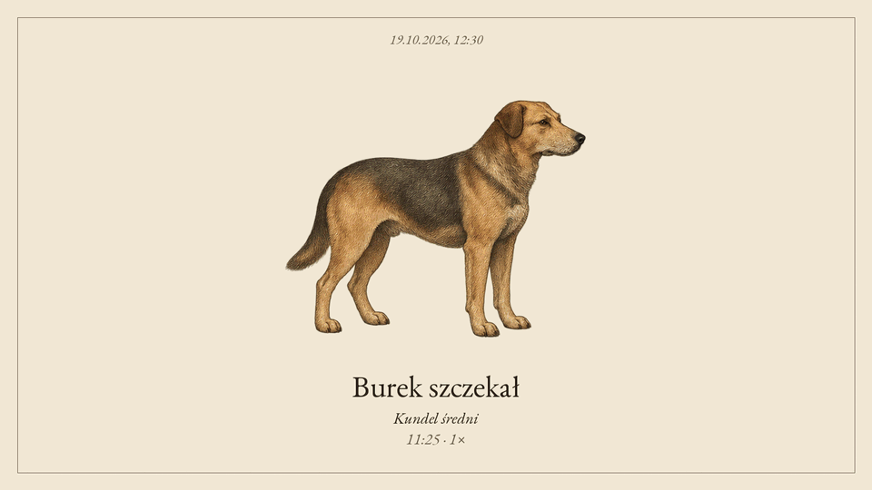

# Prepared engraving animations

The browser can play reviewed stop-motion frames over the existing product plate.
The paper, captions, layout, and static-device outputs remain unchanged. Playback
and generation are separate. The browser and Docker build never call an image
model. Missing or invalid bundles use the still image.

## Original seven-atlas pack

The repository ships seven generated atlases and seven prepared bundles from the
original pack:

| atlas | exact binding |
| --- | --- |
| `pies.png` | `DOG / Kundel średni` |
| `kos.png` | `BIRD / Turdus merula` |
| `dzwon.png` | `SCENE / bells` |
| `kosiarka.png` | `SCENE / mower` |
| `cessna-208.png` | `PLANE / C208-plain` |
| `gramofon.png` | `SCENE / music` |
| `embraer-e175-lot.png` | `PLANE / E75S-LOT` |

Raw sheets, prompts, reference hashes, sheet hashes, and provider provenance are
in [`docs/animation-atlases/catalog.json`](animation-atlases/catalog.json).
`moving-images.gif` is the review montage. The canonical prompt is
`homeassistant/ryciny/app/ryciny/animation-prompt.txt`.



## Pack 3: ten canonical bird atlases

The third pack adds ten prepared bundles bound to the exact BirdNET scientific
keys used by the bird journal:

| atlas | exact binding |
| --- | --- |
| `pack-3/aegithalos-caudatus.png` | `BIRD / Aegithalos caudatus` |
| `pack-3/anas-platyrhynchos.png` | `BIRD / Anas platyrhynchos` |
| `pack-3/ardea-cinerea.png` | `BIRD / Ardea cinerea` |
| `pack-3/buteo-buteo.png` | `BIRD / Buteo buteo` |
| `pack-3/columba-palumbus.png` | `BIRD / Columba palumbus` |
| `pack-3/dendrocopos-major.png` | `BIRD / Dendrocopos major` |
| `pack-3/erithacus-rubecula.png` | `BIRD / Erithacus rubecula` |
| `pack-3/hirundo-rustica.png` | `BIRD / Hirundo rustica` |
| `pack-3/pica-pica.png` | `BIRD / Pica pica` |
| `pack-3/upupa-epops.png` | `BIRD / Upupa epops` |

[Review montage for pack 3](animation-atlases/pack-3/moving-images.gif)
contains these ten new atlases. [Pack 3 attribution](animation-atlases/pack-3/ATTRIBUTION.md)
records the canonical restoration and selected historical plate for each item.
Each catalog entry retains the upstream reference URL and both the raw
reference and prepared PNG hashes.

Each runtime pack contains `original.png`, `manifest.json`, and six authored
red, green, blue, and alpha frames under `frames/000.png` through `frames/005.png`. The closing pose is
not stored twice: playback returns to frame zero after frame five. The compact
manifest records the exact kind and key, the original source digest, atlas
sheet digest, provider, optional model, and `frame_ms: 180`.

## Prepare or generate

The command-line tool plans work locally by default and makes no network request:

```bash
python tools/generate_animation.py \
  --source homeassistant/ryciny/app/ryciny/prepared-animations/DOG/kundel-sredni/original.png \
  --kind DOG --key 'Kundel średni' \
  --subject 'a medium-sized mixed-breed dog' \
  --motion 'one bark, then settle' --model gpt-image-2.5-sunburst
```

The command needs `--subject`. `--motion` is optional. The default mode prints a
redacted plan and reads no API key. Add `--generate` only for an explicit keyed
image request.

Use `--sheet path/to/existing-1536x1024.png` to import an atlas for local
preparation. The default mode does not need `--output`. The command requires
`--output` with `--sheet` or `--generate`. That path names a new pack directory.

The checked-in examples came from the built-in OpenAI image tool without a user
API key. Its backend model was unavailable, so the catalog records
`backend_model: null`. The catalog prompts and hash values are the source of
truth. Preparing or playing a checked-in pack does not call a provider.

## Runtime switches and fallbacks

- `animation_playback` defaults to `false`.
- `animation_generate` defaults to `false` and needs an OpenAI key.
- `RYCINY_ANIMATION_PLAYBACK` is unset and overrides playback locally.
- `RYCINY_ANIMATION_GENERATE` is unset and overrides generation locally.
- `INCLUDE_ANIMATIONS` defaults to `1`. Set it to `0` to omit prepared assets.

Keep the still image when playback is off, the source digest changes, or a pack
fails validation. Static-only platforms keep their existing image paths. Android,
e-ink, and Samsung The Frame do not use these browser packs. The browser uses the
exact `kind` and `key`. It never infers a nearby key from a picture. Generation is
opt-in and does not run during playback or image caching.
